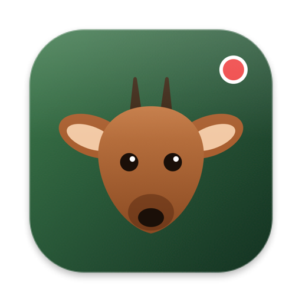
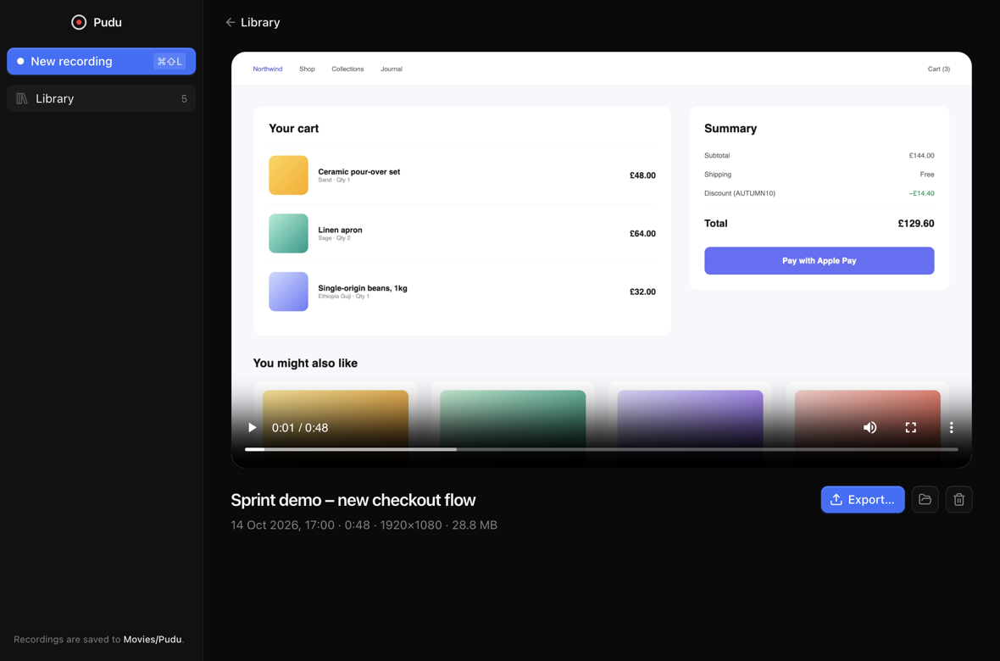
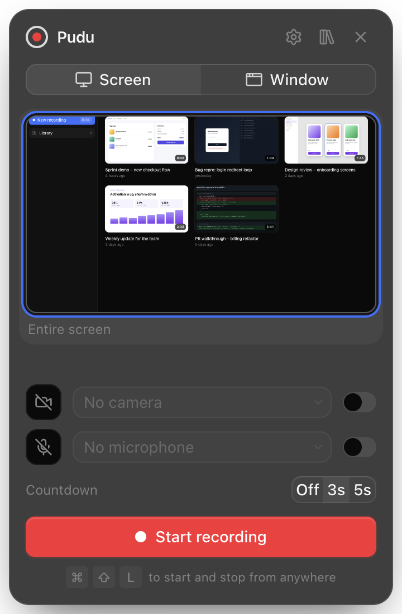
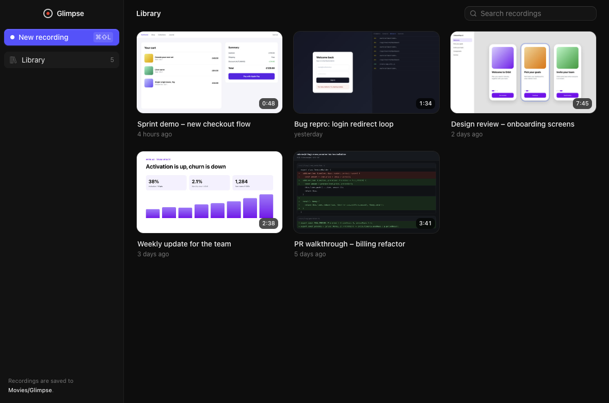
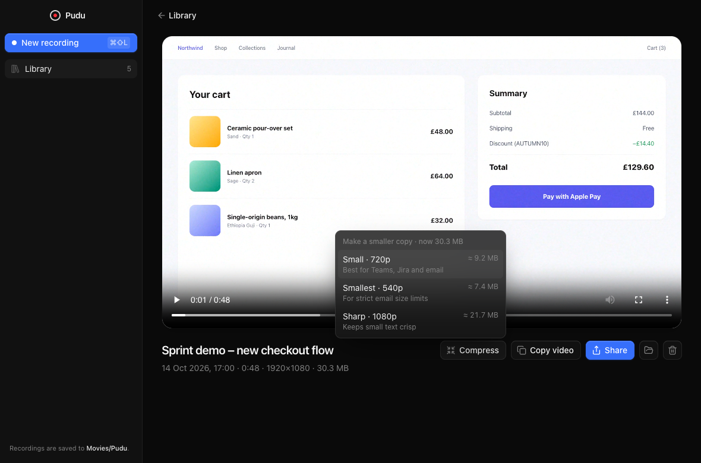
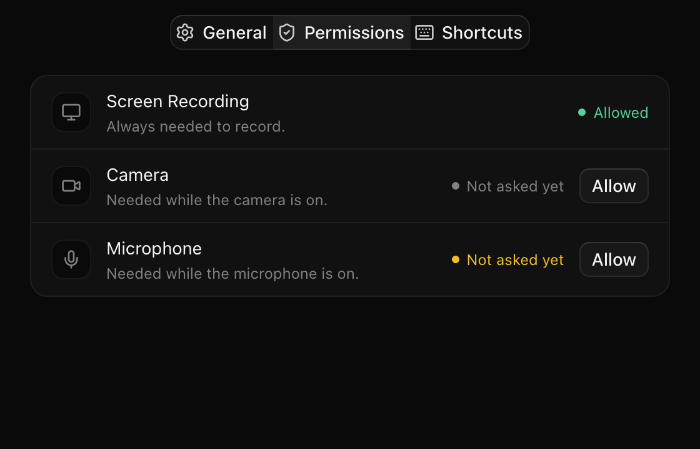

<div align="center">



# Pudu

**Record your screen with your face in a bubble. Share it anywhere.**

A small, fast, open-source Loom for macOS. No account, no upload, no subscription.<br />
Your videos stay on your Mac as plain MP4 files.<br />
<sub>Named after the pudú, the world's smallest deer, from the forests of southern Chile.</sub>

[](#install)
[](#install)
[](LICENSE)
[](https://www.electronjs.org)
[](https://react.dev)

[**Download**](https://github.com/JorgeMenaDev/pudu/releases/latest) · [Features](#features) · [Shortcuts](#keyboard-shortcuts) · [Build from source](#build-from-source)

<br />

<picture>
  <source media="(prefers-color-scheme: light)" srcset="assets/screenshots/detail-light.png" />
  
</picture>

</div>

## Why Pudu

You want to show a teammate a bug, walk through a pull request or send a quick update. A video says it faster than a document. But most screen recorders want an account, upload everything to their cloud and charge per seat.

Pudu does the useful part and nothing else:

- **One shortcut to start.** Press <kbd>⌘</kbd> <kbd>⇧</kbd> <kbd>L</kbd> from any app, talk, then press it again.
- **You, in a bubble.** Your camera floats over the screen, so people see who is talking.
- **A file you own.** Every take is an H.264 MP4 in `~/Movies/Pudu`. Drop it into Teams, Slack, Jira, email or Google Drive.
- **Small enough to send.** One click makes a copy that fits in an email.

## Features

### Start a recording

<picture>
  <source media="(prefers-color-scheme: light)" srcset="assets/screenshots/launcher-light.png" />
  
</picture>

Pudu lives in the menu bar as a small pudú face. Click it or **New recording**. Pick a whole screen or a single window, then your camera and microphone. A level meter shows that your mic can hear you.

Recording starts after a 3-second countdown. Click the countdown to skip it, or turn it off.

### Camera bubble

Drag the bubble anywhere. Hover over it to switch between three sizes or to flip the mirror. The bubble is part of the video, so it appears in the recording exactly where you left it.

### Recording toolbar

A small floating toolbar has **stop**, **pause**, **restart** and **delete**, with a running timer. It sits over your screen while you record, but it never appears in the video.

### Library

<picture>
  <source media="(prefers-color-scheme: light)" srcset="assets/screenshots/library-light.png" />
  
</picture>

When you stop, the take opens in your library, ready to watch. From there you can:

- **Rename** it by clicking the title.
- **Export** it at full size or smaller: copy, save or share the file.
- **Show in Finder** and **Delete**.

### Export and share

<picture>
  <source media="(prefers-color-scheme: light)" srcset="assets/screenshots/export-light.png" />
  
</picture>

**Export…** opens one panel. Pick a size, then:

- **Copy to clipboard** puts the file itself on the clipboard. Paste it into Teams, Slack, Mail or Finder with <kbd>⌘</kbd> <kbd>V</kbd>.
- **Save to…** saves a copy wherever you choose.
- **Share…** opens the macOS share menu: AirDrop, Mail, Messages, Notes and more.
- **Show in Finder** shows the file.

**Original** is ready at once. Full-resolution screen recordings are big, though, and email and chat apps have limits. Pick a smaller size and Pudu first makes a copy with the video converter built into macOS. It takes a few seconds and needs nothing extra installed. Until the copy is ready, its size is an estimate.

The copy stays with its recording, next to the original in `~/Movies/Pudu`. Pick the same size later and it is ready at once. If the copy was deleted in Finder, Pudu makes it again. Delete the recording and its copies go too. Sizes that would barely shrink the file are not offered.

| Size | Best for | Typical size per minute |
| --- | --- | --- |
| **1080p** | Code and small text that must stay crisp | about 28 MB |
| **720p** | Teams, Jira, Slack and most email | about 12 MB |
| **540p** | Strict email limits (Outlook 20 MB, Gmail 25 MB) | about 10 MB |

For comparison, the original of a full-screen recording on a large display is about 50 MB per minute. The copy is a standard H.264/AAC MP4 with "fast start", so it plays inline in Teams, Jira, Slack, Outlook and Gmail, and on Windows, Android and iOS.

### Settings

<picture>
  <source media="(prefers-color-scheme: light)" srcset="assets/screenshots/settings-light.png" />
  
</picture>

Right-click the menu bar icon for your last three recordings, **Settings…** and **Open at login**. The gear in the launcher opens Settings too.

- **General:** open at login, the countdown, and the recordings folder.
- **Permissions:** Screen Recording, Camera and Microphone, each with its status. Camera and Microphone have one button: **Allow** while macOS can still ask, otherwise **Open System Settings**. Screen Recording is allowed only in System Settings. Its **Open System Settings** button adds Pudu to the Screen Recording list and opens it. After that, **Restart Pudu** appears, because macOS applies the change only after a relaunch.
- **Shortcuts:** the four global shortcuts.

<picture>
  <source media="(prefers-color-scheme: light)" srcset="assets/screenshots/tray-light.png" />
  
</picture>

When the current setup is missing a permission, the menu bar icon shows a small warning mark, its tooltip names the permission, and the menu offers **Fix permissions…**. Screen Recording is always needed. Camera and Microphone are needed only while they are on.

## Keyboard shortcuts

These work from any app. They match Loom's defaults, so your hands already know them.

| Shortcut | Action |
| --- | --- |
| <kbd>⌘</kbd> <kbd>⇧</kbd> <kbd>L</kbd> | Start or stop recording |
| <kbd>⌥</kbd> <kbd>⇧</kbd> <kbd>P</kbd> | Pause or resume |
| <kbd>⌘</kbd> <kbd>⇧</kbd> <kbd>R</kbd> | Restart the take |
| <kbd>⌥</kbd> <kbd>⇧</kbd> <kbd>C</kbd> | Cancel and delete (asks first) |

While recording, click the menu bar icon to stop. Right-click it for the other actions.

## Install

1. Download the latest `Pudu-…-arm64.dmg` from [Releases](https://github.com/JorgeMenaDev/pudu/releases/latest).
2. Open it and drag **Pudu** to **Applications**.
3. Builds after v0.1.0 are signed and notarized by Apple, so they open like any app. v0.1.0 is not: macOS blocks its first launch. Open **System Settings → Privacy & Security** and click **Open Anyway** (on macOS 14, right-click **Pudu** in Applications and choose **Open**). If macOS still refuses, run:

   ```sh
   xattr -dr com.apple.quarantine /Applications/Pudu.app
   ```

4. Allow **Screen Recording**, **Camera** and **Microphone** when macOS asks. For Screen Recording, macOS asks you to quit and reopen Pudu.

Pudu needs macOS 14 or later on Apple silicon.

Want changes first? Every merged change ships as a beta: download the newest **Pre-release** from [Releases](https://github.com/JorgeMenaDev/pudu/releases).

## Privacy

Pudu has no account, no server, no analytics and no network calls. Recordings are written to `~/Movies/Pudu` and never leave your Mac unless you share them.

## Build from source

You need [Bun](https://bun.sh) 1.2 or later and Xcode command line tools.

```sh
git clone https://github.com/JorgeMenaDev/pudu.git
cd pudu
bun install
bun run dev      # Vite + Electron; the interface hot-reloads
bun run dist     # builds apps/desktop/release/Pudu-<version>-arm64.dmg
```

Other scripts: `bun run typecheck`, `bun test`, `bun run build`, `bun run start`.

> If your terminal sets `ELECTRON_RUN_AS_NODE=1` (some editor terminals do), Electron starts as plain Node. Run `env -u ELECTRON_RUN_AS_NODE bun run dev` instead.

## How it works

Pudu follows the architecture of [T3 Code](https://github.com/pingdotgg/t3code): an Electron shell, one React renderer and a shared contracts package.

```
packages/contracts   Types and IPC channel names shared by every process
apps/desktop         Electron main process
  studio.ts            The recording lifecycle and its windows (the single source of state)
  windows.ts           Window factories: library, launcher, settings, bubble, toolbar, countdown, recorder
  library.ts           Recordings on disk: <id>.mp4 + <id>.jpg + <id>.json, plus share copies (<id>.720p.mp4)
  compress.ts          Share copies through macOS's built-in avconvert
  mediaProtocol.ts     pudu-media:// with byte ranges, so the player can seek
  preload.ts           The window.pudu bridge
apps/web             React 19 + Vite + Tailwind 4; one bundle for every window (#/surface)
  surfaces/            Library, Launcher, Settings, Bubble, Controls, Countdown, Recorder (hidden)
  components/ui/       T3 Code's Base UI component kit
```

A take, step by step:

1. The main process owns the recorder state and broadcasts every change to all windows.
2. **Start** opens a hidden recorder window. It captures the chosen screen or window with Chromium's desktop capture, plus the microphone.
3. After the countdown, `MediaRecorder` encodes H.264 + AAC in hardware and streams one chunk per second to disk.
4. **Stop** finalises the file, saves a thumbnail and metadata, and opens the take in the library.

The toolbar, countdown and launcher use `setContentProtection(true)`, so macOS leaves them out of the capture. The camera bubble does not, so it is recorded.

## Roadmap

What comes next, from a better menu bar and one Export panel to system audio and trimming: see [ROADMAP.md](ROADMAP.md).

Issues and pull requests are welcome.

## Credits

- [T3 Code](https://github.com/pingdotgg/t3code) by T3 Tools Inc. Pudu borrows its architecture, theme and UI components (MIT; see [NOTICE](NOTICE)).
- [Loom](https://www.loom.com) for showing how good async video can feel. Pudu is an independent project and is not affiliated with Loom or Atlassian.

## Licence

[MIT](LICENSE) © 2026 Jorge Mena
